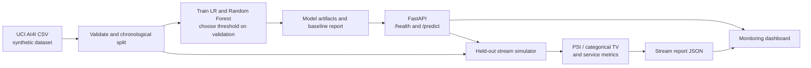

# PulseWatch architecture

## Data and trust boundaries

- The CSV is downloaded separately from UCI and is not included in the Git
  repository or container image.
- Training creates `artifacts/` locally. The serialized model is loaded by the
  API; treat joblib artifacts as trusted local files, not user uploads.
- `/predict` receives one validated operating measurement and returns a risk
  score, threshold decision, model metadata, and inference time.
- The simulator sends held-out feature rows to the API. It does not send labels;
  therefore its drift report cannot measure live predictive quality.
- The dashboard reads generated JSON reports. It is a local demonstration UI,
  not an authenticated production monitoring console.

## Key design choices

Threshold selection uses validation data only; test metrics are produced after
the decision threshold is fixed. Drift (PSI and categorical total variation) is
reported separately from classification quality. A drift alert is a prompt to
investigate, not proof that performance has degraded.
